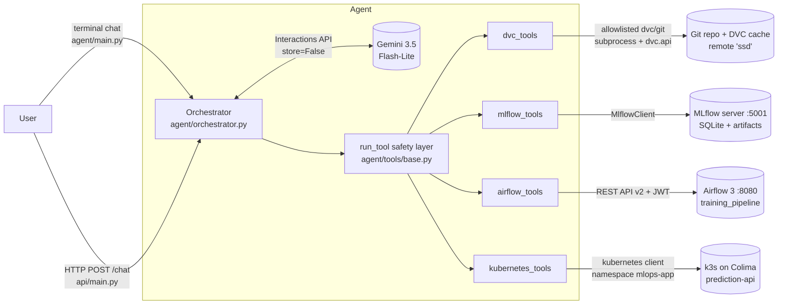
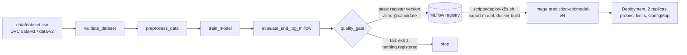
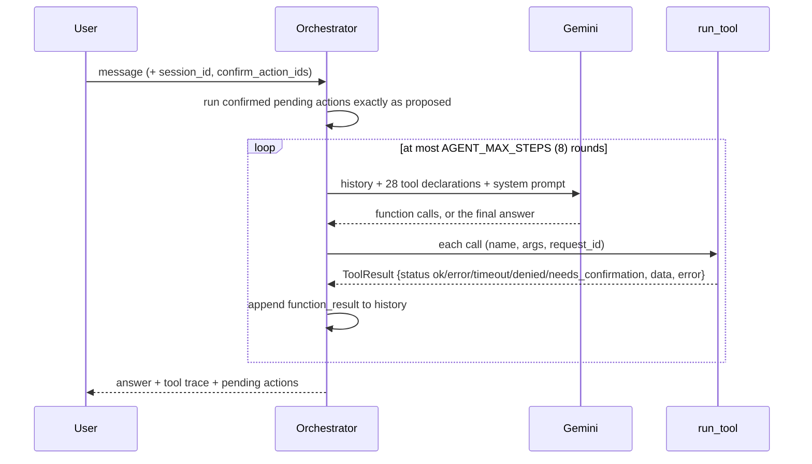

# Architecture

An AI agent that answers operational questions about an ML system by calling tools against the
real infrastructure: DVC (data), MLflow (experiments and registry), Airflow 3 (training pipeline)
and Kubernetes (prediction service). Every operational fact in an answer comes from a tool result.
The model only chooses tools and writes up what they returned.

## Components

The training pipeline exists twice with the same five stages: as the Airflow DAG
(`dags/training_pipeline.py`, the orchestrated path with retries and logging) and as `dvc.yaml`
(local `dvc repro`, so DVC can tell which stages are stale). Every run records its provenance as
MLflow tags: `data_version`, `data_md5`, `git_commit`, `git_dirty`, `pipeline`, `quality_gate`. The
serving image carries the same metadata and reports it at `/version`, so the agent can trace a live
pod back to the exact data and code.

## One request

## Safety: one path for every tool call

`run_tool` (`agent/tools/base.py`) is the only way a tool runs, whether the model or a confirmation asked for it:

1. **Validate** the arguments with the tool's Pydantic model. Bad input never reaches a system, and
   the error says which field failed.
2. **Permission check** (`precheck`): Kubernetes tools only work in `mlops-app`
   (`ALLOWED_NAMESPACES`), and `trigger_dag` only accepts DAGs in `APPROVED_DAGS`. DVC/git
   commands come from a read-only allowlist. Paths must stay inside the repo.
3. **Confirmation**: the three state-changing tools (`trigger_dag`, `restart_deployment`,
   `scale_deployment`) return `needs_confirmation`, and the orchestrator stores a `PendingAction`
   with a random id. The action only runs when the *user's request* carries that id in
   `confirm_action_ids`. It then runs with the stored arguments, not new ones from the model, and the id is single-use. The model
   has no way to set `confirmed=True`.
4. **Timeout**: each call runs in a worker thread with a deadline (20 s, 320 s for
   `wait_for_dag_run`), and every HTTP client has its own timeout. MLflow retries are disabled so
   a dead server fails fast.
5. **Error capture**: expected failures (`ToolError`), denials and unexpected exceptions all become
   a `ToolResult` with `data=None`. The model sees the error and never receives made-up data.
6. **Structured log**: one JSON line per call with `request_id`, tool, status, duration and
   arguments, with secrets redacted (`password`, `token`, `secret`, `key`, `authorization`). Chat
   requests log one line too. Secrets live only in `.env` (gitignored).

The system prompt adds behavioural rules on top of this: facts only from tools, report failed or
denied tools, gather evidence from all four systems for state and retraining questions, recommend
retraining only on evidence (failed gate, older data, the 30-day freshness policy, supplied
degradation), and treat a top metric as not enough for production. These rules are guidance; the
guarantees come from `run_tool`.

## Design choices

| Choice | Why |
|---|---|
| Direct function calling on the Gemini Interactions API, no agent framework | The loop is about 60 lines and fully visible. The safety layer sits in our code, not inside a framework callback. |
| `store=False`, history kept in the orchestrator | Infrastructure data (logs, run ids, hostnames) is not stored at the provider. Sessions are in memory. |
| Gemini 3.5 Flash-Lite | Fast and cheap for many short tool rounds. Its weaknesses (see the report) are covered by the safety layer and tests, not trusted away. |
| `MlflowClient` | Required by the brief, and typed results instead of scraping the UI. |
| Airflow REST API v2 with JWT (`/auth/token`) | Supported Airflow 3 interface. The token is cached and refreshed once on 401. |
| Official `kubernetes` Python client | Structured objects (container states, conditions) instead of parsing `kubectl` text. The service proxy reads the live `/version`. |
| DVC through an allowlisted subprocess plus `dvc.api` | DVC has no stable API for status/diff; the allowlist keeps it read-only. |
| `wait_for_dag_run` as one tool | The model polled `get_dag_run_status` in a loop until it hit the step limit. Waiting belongs in code. |
| Separate venvs for agent and Airflow | Airflow pins many dependencies. The DAG calls the project venv, so the two never conflict. |

## Runtime layout

| Service | Address | Started by |
|---|---|---|
| MLflow tracking + registry | `127.0.0.1:5001` | `scripts/start-mlflow.sh` |
| Airflow 3 (api-server, scheduler, dag-processor, triggerer) | `127.0.0.1:8080` | `scripts/start-airflow.sh` |
| Agent HTTP API | `127.0.0.1:8000` | `uvicorn api.main:app --port 8000` |
| Kubernetes (k3s in Colima) | namespace `mlops-app`, ClusterIP service `prediction-api:80` | `kubectl apply -f kubernetes/` or `scripts/deploy-k8s.sh` |

All heavy state (virtualenvs, MLflow DB and artifacts, DVC cache and remote, Airflow home, Docker
images) lives on an external SSD under `DATA_ROOT`, outside the repository.
