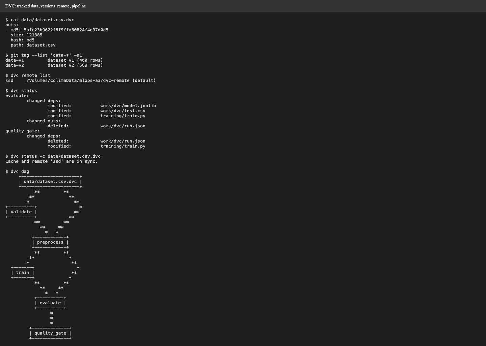
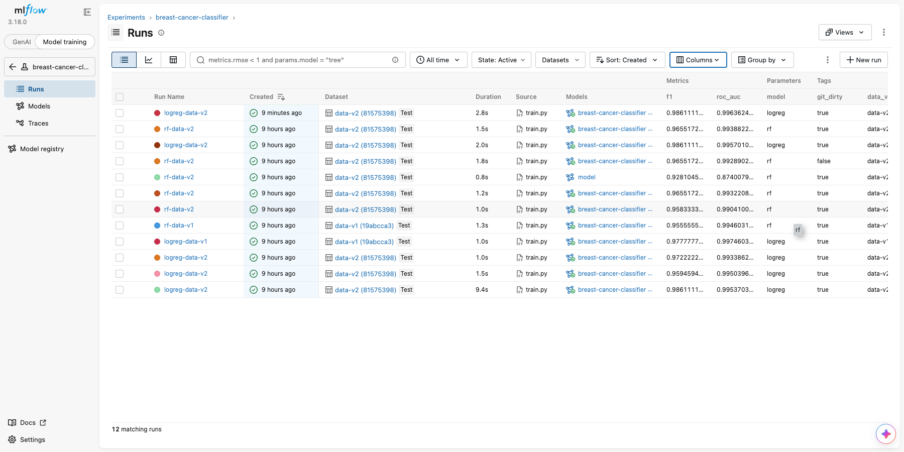
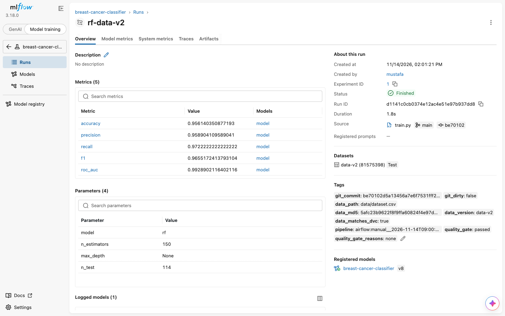
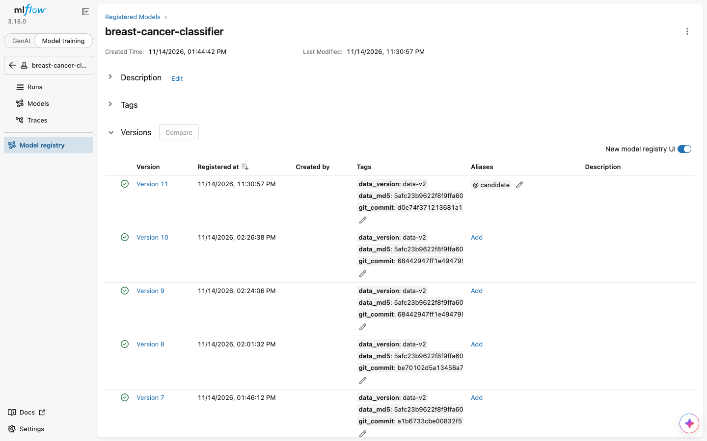
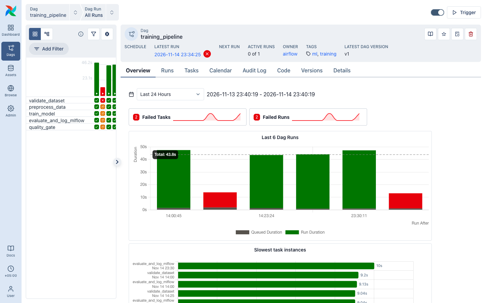
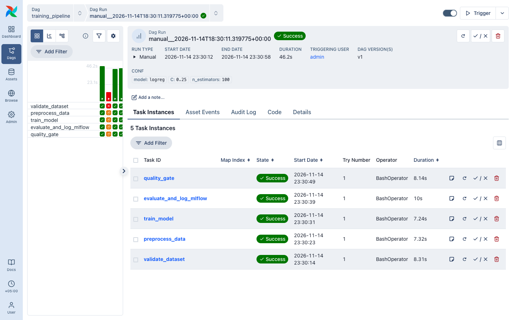
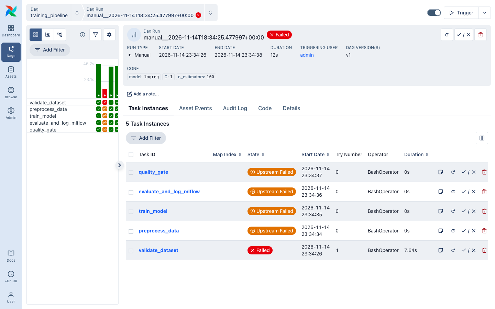
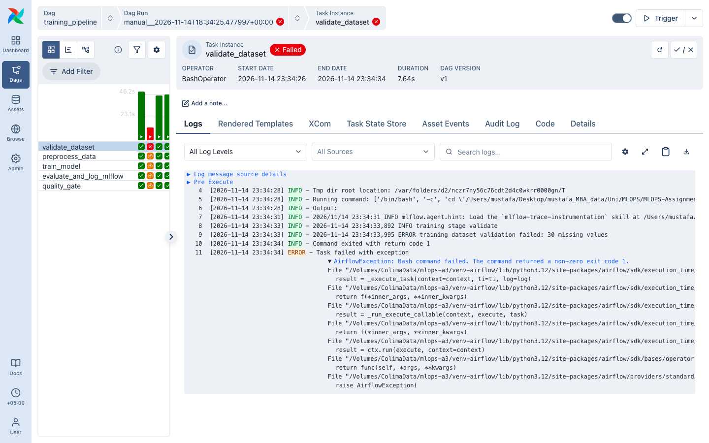
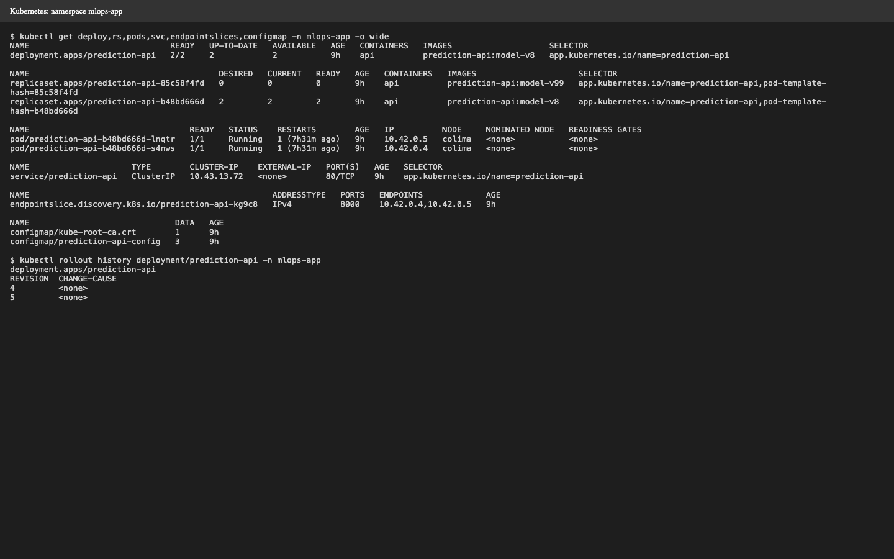
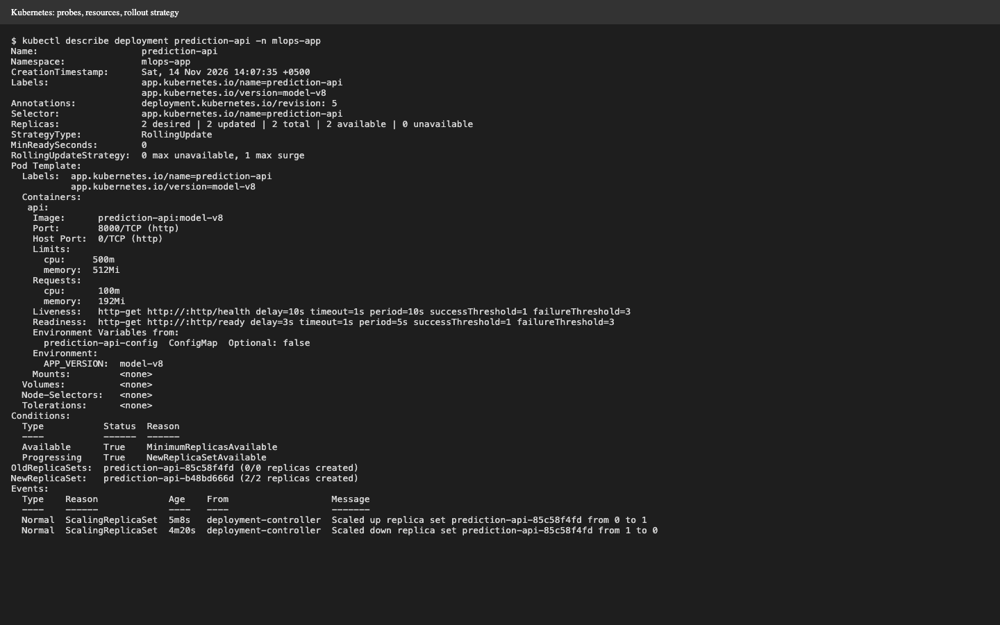

# Technical report: MLOps AI agent (Assignment 3)

Repository layout, setup and launch instructions are in the [README](../README.md). The full
architecture is in [architecture.md](../architecture.md). This report covers the items the brief
asks for: architecture, tool definitions and permissions, evidence from the four systems, five
tested conversations, two failure investigations, and limitations.

## 1. System in one paragraph

A breast-cancer classifier (scikit-learn) is trained on a DVC-versioned dataset (`data-v1`: 400
rows, `data-v2`: 569 rows) by an Airflow 3 DAG: validate → preprocess → train →
evaluate/log to MLflow → quality gate (F1 ≥ 0.95, ROC-AUC ≥ 0.97). Runs that pass the gate are
registered in the MLflow registry with the alias `@candidate`. A registered version is exported into a FastAPI image and
deployed to Kubernetes (2 replicas, probes, limits, ConfigMap). The agent (Gemini 3.5 Flash-Lite,
direct function calling, 28 tools) answers questions over all four systems through a terminal chat
or `POST /chat`. All tool calls go through one safety layer that validates, checks permissions,
requires user confirmation for state changes, enforces timeouts and logs in JSON.

## 2. Architecture

See [architecture.md](../architecture.md) for the component and request diagrams, the safety
layer step by step, and the reasoning behind each technology choice. Summary:

- **Interfaces:** `agent/main.py` (terminal) and `api/main.py` (FastAPI: `/chat`, `/tools`, `/health`).
- **Orchestrator:** `agent/orchestrator.py`, a stateless Interactions API loop (`store=False`),
  at most 8 tool rounds per request, sessions and pending actions held in memory.
- **Tools:** `agent/tools/{dvc,mlflow,airflow,kubernetes}_tools.py`, registered with a decorator.
  The docstring is the description the model sees, and the Pydantic model is the input schema.
- **Safety layer:** `agent/tools/base.py::run_tool`.

## 3. Tool definitions and permissions

Generated from the live tool registry. Inputs are validated Pydantic models (ranges and enums are
enforced, e.g. replicas 1–5, model ∈ {logreg, rf}, paths must stay inside the repo).

**DVC**

| Tool | Inputs | Access | What it does |
|---|---|---|---|
| `list_tracked_datasets` | – | read-only | List files tracked by DVC with their current md5/size, and all tagged dataset versions. |
| `get_dataset_version` | `path` | read-only | Current version of a dataset: DVC md5, matching data-* tag, the git commit that last changed it, HEAD, and whether the file on disk still matches what DVC tracks. |
| `compare_dataset_versions` | `path`, `rev_a`, `rev_b` | read-only | Compare two dataset versions (git tags/commits): md5, size, row counts and DVC diff. |
| `check_data_changes` | – | read-only | Detect whether DVC-tracked data on disk differs from what is committed (dvc status), whether any .dvc pointer files have uncommitted changes, and which dvc.yaml pipeline stages are stale. |
| `get_dataset_for_run` | `run_id` | read-only | Which dataset version an MLflow run was trained on (from the provenance it recorded), checked against DVC, plus the exact commands to reproduce that data. |
| `explain_reproduce_dataset` | `path`, `rev` | read-only | Explain how to restore a previous dataset version (does not change anything), after checking that the version exists and recording its md5 and row count. |

**MLflow**

| Tool | Inputs | Access | What it does |
|---|---|---|---|
| `list_experiments` | – | read-only | List MLflow experiments with id, name and creation time. |
| `list_runs` | `experiment`, `max_results` | read-only | List the most recent training runs of an experiment with metrics, params and provenance tags (data_version, git_commit, quality_gate). |
| `get_run_details` | `run_id` | read-only | Get one run's metrics, parameters, provenance tags, artifacts and any registered model versions created from it. |
| `find_best_run` | `metric`, `experiment`, `last_n`, `higher_is_better` | read-only | Rank recent finished runs by a metric and return the best one, the ranking and caveats that matter before calling it production-ready (quality gate, data version, registry status). |
| `compare_runs` | `run_ids`, `last_n`, `experiment`, `metrics` | read-only | Compare several runs side by side (given run ids, or the last N runs) on chosen metrics and say which run leads each metric. |
| `compare_experiments` | `experiments`, `metric` | read-only | Compare two or more experiments: number of finished runs and the best run on a metric. |
| `get_model_registry` | `model_name` | read-only | List registered model versions with aliases (e.g. @candidate), source run, metrics, data version and quality-gate result. |

**Airflow**

| Tool | Inputs | Access | What it does |
|---|---|---|---|
| `list_dags` | – | read-only | List Airflow DAGs with paused state, tags, import errors and whether the agent may trigger them. |
| `list_dag_runs` | `dag_id`, `limit` | read-only | List the most recent runs of a DAG with state, timing and the config they ran with. |
| `get_dag_run_status` | `dag_id`, `dag_run_id` | read-only | Status of one DAG run (or the latest) with every task's state, try number and duration. |
| `wait_for_dag_run` | `dag_id`, `dag_run_id`, `max_wait_s` | read-only; timeout 320 s | Wait until a DAG run (or the latest) finishes, polling every 5 s, then return its final state, task states and, if it failed, the error lines of the failed tasks. |
| `find_failed_tasks` | `dag_id`, `limit` | read-only | Find failed tasks in recent failed runs of a DAG, with the error lines from their logs and which downstream tasks were blocked. |
| `get_task_log` | `dag_id`, `dag_run_id`, `task_id`, `try_number`, `tail` | read-only | Last lines of a task's log for one try of a DAG run (default: latest run, latest try). |
| `trigger_dag` | `dag_id`, `conf` | **state change**, needs user confirmation; `_approved_dag` | Trigger an approved training DAG with a model config. |

**Kubernetes**

| Tool | Inputs | Access | What it does |
|---|---|---|---|
| `list_workloads` | `namespace` | read-only; `allowed_namespace` | List Deployments (desired/ready/updated replicas, image, version, conditions) and Pods (phase, readiness, restarts, waiting reasons) in the application namespace. |
| `get_pod_logs` | `namespace`, `pod`, `tail_lines`, `previous` | read-only; `allowed_namespace` | Last log lines of a pod (use previous=true for the container that crashed before a restart). |
| `inspect_services` | `namespace` | read-only; `allowed_namespace` | List Services with type, ports and how many ready/not-ready endpoints back each one. |
| `get_events` | `namespace`, `warnings_only`, `limit` | read-only; `allowed_namespace` | Recent namespace events (default: warnings only), e.g. failed pulls, probe failures, back-offs. |
| `find_unhealthy_pods` | `namespace` | read-only; `allowed_namespace` | Health check of the namespace: pods that are not ready, waiting (e.g. ImagePullBackOff, CrashLoopBackOff) or have restarted, deployments with a stalled rollout, and warning events. |
| `get_deployed_version` | `namespace`, `deployment` | read-only; `allowed_namespace` | Currently deployed application version: image tag, version label, rollout revision, and the model version/provenance reported live by the service's /version endpoint. |
| `restart_deployment` | `namespace`, `deployment` | **state change**, needs user confirmation; `allowed_namespace` | Rolling restart of a deployment (like `kubectl rollout restart`). |
| `scale_deployment` | `namespace`, `deployment`, `replicas` | **state change**, needs user confirmation; `allowed_namespace` | Scale a deployment to 1-5 replicas. |

**Permission model**

| Rule | Where it is enforced | Tested by |
|---|---|---|
| Only 3 of 28 tools can change state, and each needs the user to confirm its action id | `run_tool` + `Agent.chat` | `test_mutating_tool_needs_confirmation_then_runs_with_given_args`, `test_state_change_waits_for_the_user_and_runs_exactly_as_proposed`, `test_model_cannot_approve_its_own_action` |
| Confirmed actions run with the proposed arguments; ids are single-use | `Agent.chat` (`session.pending.pop`) | same as above |
| Kubernetes reads and changes are limited to namespace `mlops-app` | `allowed_namespace` precheck | `test_kubernetes_outside_allowed_namespace_is_denied_even_when_confirmed` |
| Only DAG `training_pipeline` can be triggered | `_approved_dag` precheck | `test_trigger_dag_only_for_approved_dags` |
| DVC/git: read-only allowlist (`dvc status/diff/remote`, `git show/log/tag/rev-parse/ls-files/status`) | `run_cmd` | `test_dvc_tools_only_run_allowlisted_read_only_commands` |
| No promotion or deployment tool: the agent recommends, and a human runs `scripts/deploy-k8s.sh` | by design | – |
| Secrets only in `.env` (gitignored) and redacted in logs | `redact()` | `test_every_call_writes_one_structured_log_line_with_secrets_redacted` |

## 4. Evidence from DVC, MLflow, Airflow and Kubernetes

All screenshots were captured from the running systems by `scripts/screenshots.py`.

**DVC**

- [docs/evidence/dvc_reproducible_checkout.txt](evidence/dvc_reproducible_checkout.txt) shows the
  reproducible checkout. Switching the pointer to `data-v1` and running `dvc checkout` gives 400
  rows with md5 `2c0ae313…`. Switching back gives 569 rows with md5 `5afc23b9…`. Each md5 matches
  its DVC pointer, and the dataset is in the `ssd` remote.
- [docs/evidence/dvc_pipeline.txt](evidence/dvc_pipeline.txt) is the output of `dvc repro train`
  (validate → preprocess → train) and `dvc dag`.

*DVC pointer, version tags, remote, cache/remote sync and the `dvc.yaml` pipeline. `evaluate` and
`quality_gate` show as not yet run through DVC on purpose: they log to MLflow and may register a
model, so the evidence run stopped at `train`.*

**MLflow**

*All 12 runs with F1, ROC-AUC, model type, `git_dirty` and dataset version. The one run with
F1 0.928 is the gate-failed run, and it has no registered model (the "model" link instead of a
registry link).*

*The deployed run `d1141c0c`: provenance tags (data-v2, md5, commit `be70102`, `git_dirty: false`,
gate passed, Airflow run id) and its registered version v8.*

*Registry: versions with data and commit tags. `@candidate` points to the latest gate-passing version (v11).*

**Airflow**

*`training_pipeline`: the grid of recent runs (two failed at `validate_dataset`, with downstream tasks
`upstream_failed`) and run durations.*

*Run triggered by the agent in scenario 3 (logreg, C=0.25): all five tasks succeeded.*

*Failure investigation 1: `validate_dataset` failed, and the four downstream tasks were `upstream_failed`.*

*The log line the agent quoted: `dataset validation failed: 30 missing values`.*

**Kubernetes**

*Deployment 2/2 on `model-v8`, the scaled-down `model-v99` ReplicaSet left over from failure
investigation 2, the ClusterIP service with 2 endpoints, and the ConfigMap.*

*Rolling update `maxUnavailable 0 / maxSurge 1`, CPU and memory requests and limits, liveness `/health`,
readiness `/ready`, and config from the ConfigMap.*

## 5. Five tested conversations

Each transcript lists every tool the agent actually called (arguments, status, duration) and the
answer, followed by a reviewer check of the answer against the systems. They were recorded through
the HTTP API with `scripts/record_chat.py`.

| # | Scenario | Tools used | Outcome |
|---|---|---|---|
| 1 | [Dataset provenance](conversations/01-dataset-provenance.md) | `get_deployed_version`, `get_model_registry`, `list_runs`, `get_dataset_for_run`, `explain_reproduce_dataset` | Deployed v8 → run `d1141c0c` → `data-v2`, md5 `5afc23b9…`, commit `be70102`, and the exact checkout commands. All correct. |
| 2 | [Model selection](conversations/02-model-selection.md) | `compare_runs`, `list_runs`, `get_model_registry`, `get_deployed_version` | Ranked the last five runs, flagged the gate-failed run, and recommended v9 by F1 together with gate, data version, registry and deployment status. Did not mention the small 114-row test set. |
| 3 | [Pipeline execution](conversations/03-pipeline-execution.md) | `trigger_dag` (needs_confirmation) → user confirms → `trigger_dag`, `wait_for_dag_run` | Real Airflow run `manual__2026-11-14T18:30:11`, 5/5 tasks succeeded in 46 s. Nothing ran before the confirmation. |
| 4 | [Deployment diagnosis](conversations/04-deployment-diagnosis.md) | `find_unhealthy_pods`, `list_workloads`, `inspect_services`, `get_events`, `get_deployed_version`, `get_pod_logs` ×2 | Healthy service: 2/2 ready, past events correctly treated as history. Attempt 1 wrongly called an exit-137 restart "OOMKilled"; fixed and re-run (see §7). |
| 5 | [Multi-tool reasoning](conversations/05-multi-tool-reasoning.md) | MLflow ×2, DVC ×2, Kubernetes ×2, Airflow ×1 | Correlated all four systems and said retraining is not needed (same dataset, gate passed, no freshness or degradation evidence), recommending promotion instead. Started nothing. Attempt 1 left out Airflow and the `git_dirty` caveat; fixed and re-run. |

## 6. Two failure investigations

| # | Injected fault | Agent's diagnosis | Root cause and resolution |
|---|---|---|---|
| 1 | [Invalid data](failures/01-data-validation-failure.md): 30 empty values written into the working copy of `data/dataset.csv` | `wait_for_dag_run` + `get_task_log`: `validate_dataset` failed with "30 missing values" and the downstream tasks were blocked. `check_data_changes`: the dataset differs from the DVC-tracked `data-v2`. `list_runs`: no MLflow run was created. | Data drifted from the tracked version. Validation has 0 retries, and only the gate registers models, so nothing bad was promoted. Fixed with `dvc checkout --force` (md5 back to `5afc23b9…`). |
| 2 | [Unpullable image](failures/02-deployment-image-pull-failure.md): `kubectl set image … api=prediction-api:model-v99` | `get_deployed_version`: the spec says v99, but the label and live `/version` say v8. `find_unhealthy_pods` + `get_events`: the new pod is in `ImagePullBackOff` (repository does not exist). `inspect_services`: 2 ready endpoints, so still serving. | The image was never built. `maxUnavailable: 0` kept v8 serving the whole time. Fixed by re-applying the git manifests (`kubectl apply -f kubernetes/`), rollout complete. |

## 7. Unexpected failures found and fixed

The brief asks to diagnose at least one unexpected failure. These came up during development and
the demo runs; each led to a code change and, where testable, a test.

| Symptom | Diagnosis | Fix |
|---|---|---|
| After a confirmed trigger, the agent called `get_dag_run_status` 8 times and hit the step limit | The model cannot wait; it polls. The `trigger_dag` description also still pointed to `get_dag_run_status`. | New `wait_for_dag_run` tool (polls in code, 320 s budget), a prompt rule, and a corrected description |
| Demo 4: "pods were OOMKilled" | Kubernetes recorded `reason: Error, exit 137`, and both pods died at the same second (Colima VM restart). The model read SIGKILL as out-of-memory. | Pod summaries carry an explicit `oom_killed` flag, and the prompt forbids inferring unrecorded causes (unit-tested) |
| Demo 5: answer left out Airflow and the `git_dirty` caveat, although the tools returned them | A weak model dropping evidence when it writes the summary | Answer format requires one Findings group per system and every tool caveat; `find_best_run` also flags metric ties (unit-tested) |
| `dvc.yaml` made `check_data_changes` report data changes that did not exist | `dvc status` also lists stale pipeline stages | Only `.dvc` entries count as data changes; stale stages are listed separately (unit-tested) |
| First CI run failed in 3 s | `astral-sh/setup-uv@v10` has no floating major tag | Pinned to the v10.3.1 commit SHA |
| Airflow standalone crashed with `FileNotFoundError: 'airflow'` | Standalone launches its components through `PATH` | The start script puts the Airflow venv on `PATH` |
| Random-forest runs failed at `log_model` | MLflow's skops serializer rejected `sklearn.tree._tree.Tree` | `skops_trusted_types` for that one type |

## 8. Testing and CI

23 pytest tests (`tests/`) with every service faked: a scripted Gemini client and patched
Airflow/MLflow/Kubernetes/DVC calls. They cover tool selection and execution, invalid arguments,
denied namespaces and DAGs, user-only and single-use confirmation, timeouts, unreachable services
(the model gets an error and no data), LLM failure (HTTP 502, no answer), the step limit, JSON logs
with redaction, and the regressions from §7. Disabling the confirmation or permission checks makes
the suite fail, which was checked by hand. GitHub Actions (`.github/workflows/ci.yml`) runs ruff and
pytest on every pull request and every push to `main` with the locked environment (`uv sync --frozen`).

## 9. Known limitations and proposed improvements

| Limitation | Impact | Proposed improvement |
|---|---|---|
| The model sometimes over-states. Observed: "inference endpoints returned 200" with no `/predict` in the logs; a Kubernetes statement deduced instead of checked; a recommendation that ignored its own `git_dirty` caveat; a misspelled tool name (rejected safely) | Small unsupported claims can reach the user | Check claims after the answer against the tool results it cites; use a stronger model for the final write-up; replay recorded tool outputs as a regression eval for prompts |
| Several registered models were trained while the repo had uncommitted changes (`git_dirty=true`) | Those versions are not exactly reproducible from a commit. Resolved for production: v12 was retrained from clean commit `ec34ef0` and deployed (§10), but nothing stops it recurring | Make the quality gate fail on `git_dirty` |
| The agent uses the local kubeconfig and Airflow admin. Namespace and DAG limits are enforced in code, not by the platforms | A bug in the tool layer would not be stopped by RBAC | ServiceAccount + Role limited to `mlops-app` (get/list pods, logs, events, services; patch deployments); an Airflow user that can only trigger `training_pipeline` |
| Sessions and pending actions are in memory, the API has no auth, and it serves on localhost only | Lost on restart; not multi-user | Persist sessions (SQLite or Redis), add API auth, give pending actions an expiry |
| A timed-out tool thread keeps running until its own HTTP timeout | Only acceptable because tools are reads with timeouts | Process-based isolation if long writes are ever added |
| Model quality rests on one 114-row held-out split; there is no monitoring of live predictions | "Degradation" evidence must be supplied by the user; F1 ties are common | Cross-validation in the DAG; log predictions and expose Prometheus metrics so the agent can detect drift |
| Promotion and deployment are scripts, not agent tools | Deliberate, but the last step is manual | A confirmed `promote_model` tool that re-checks gate, data version and `git_dirty` before moving an alias |
| Single-node k3s, image loaded locally (`IfNotPresent`), DVC remote on a local disk | Not representative of multi-node or cloud setups | A container registry with immutable digests, an S3 DVC remote, lower `progressDeadlineSeconds` with rollout status reported by the agent |

## 10. Final state (after the demos)

The demos showed that every tied best candidate had `git_dirty=true`. So the DAG was re-run from
the clean commit `ec34ef0` with the v9 configuration (logreg, C=0.5), and the result was deployed:

| | Value |
|---|---|
| Airflow run | `manual__2026-11-14T18:59:44.799268+00:00`: 5/5 tasks succeeded in 39 s |
| MLflow run | `2088580338ee446ab493bef6e7c5c713`: F1 0.9861, ROC-AUC 0.9957 (identical to v9, so v9's result reproduces), `git_dirty=false`, data-v2 (md5 matches DVC), gate passed |
| Registry | version 12, alias `@candidate` |
| Kubernetes | `prediction-api:model-v12`, 2/2 ready; live `/version` reports model v12, run `20885803`, commit `ec34ef0` |
| Smoke test | `POST /predict` on 4 known rows (2 malignant, 2 benign): all correct |

The screenshots and transcripts above were taken before this redeploy, so they show v8 as deployed.
